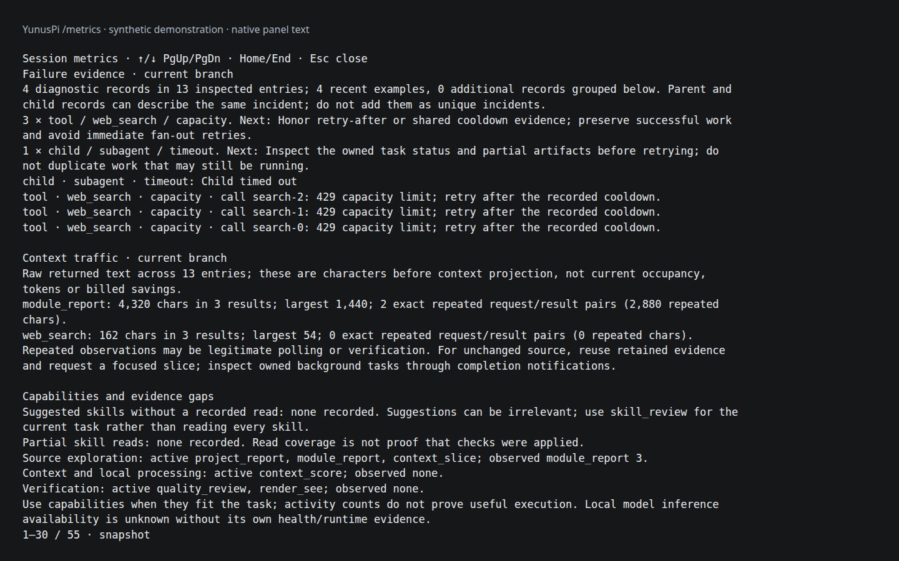
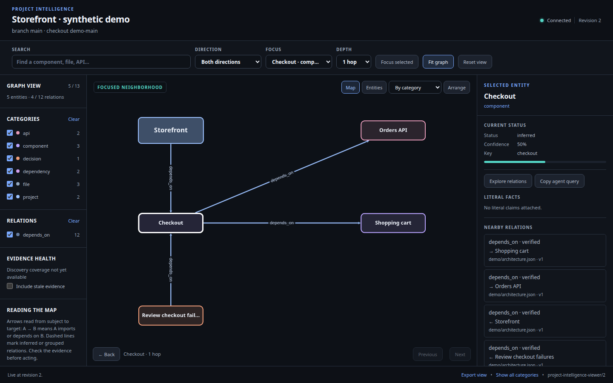

# YunusPi

<p align="center">
  
</p>

**An independent coding agent, now in a desktop workspace.**

Open a project, start a conversation, and give the rat something to work on. YunusPi runs your selected model with coding, browser, research and media tools, persistent project memory, and optional subagents. Its Electron interface keeps the conversation clear, tool activity compact, and details available when useful.

Run multiple sessions across projects, or work together in the same checkout with automatic peer awareness and overlapping-edit safeguards. Sessions keep separate histories, drafts, models and goals. Close, archive, restore, export or delete them from the session menu.

[Desktop guide](docs/DESKTOP.md) · [Install](docs/INSTALL.md) · `yunuspi --gui`

Research, code and ML · [Media creation](docs/MEDIA-CREATION.md) · [Public-site SEO](docs/SITE-SEO.md) · [Install](docs/INSTALL.md) · [Capability inventory](docs/CAPABILITIES.md) · [Platform support](docs/PLATFORMS.md) · [Tools, skills and reminders](docs/GUIDANCE-AND-DIAGNOSTICS.md) · [Model routing](docs/MODEL-ROUTING.md) · [Release/versioning](docs/PUBLISHING.md) · [Security](docs/SECURITY.md)

Pi 0.85.1 is the historical origin; YunusPi Core starts its own lineage at 0.1.0. Installation builds repository-owned source, and updates accept only explicitly selected YunusPi source. Use `yunuspi --core-info` to inspect the active identity. [Core ownership](docs/CORE-OWNERSHIP.md) · [Manual upstream ports](UPSTREAM-PORTING.md)

Sessions combine one independent observer, project memory, local inference and bounded subagents. Design, browser, media and coding tools share evidence and lifecycle controls; the capability index exposes their entry points when needed. [What changed](CHANGELOG.md) · [Intelligence architecture](docs/MICRO-INTELLIGENCE.md) · [Session observer](docs/SESSION-OBSERVER.md) · [Session coordination](docs/ACTION-PLANS.md) · [Adaptive execution](docs/ADAPTIVE-EXECUTION.md) · [Competence control](docs/COMPETENCE-CONTROL.md) · [Development pipelines](docs/TASK-PIPELINES.md)


## How a session works

Start `yunuspi` in your project directory, choose an available model, and describe the work normally. You do not need to select a workflow or browse a catalog before every task.

- **Start small.** Main sessions expose core editing, inspection, coordination and quality tools. Specialized tool schemas and the full skill catalog stay out of the initial model context.
- **Discover when useful.** The agent can browse capability groups, search short descriptions, and load selected tools or read a relevant skill. Direct search and activation are also available; browsing is optional.
- **Get gentle reminders.** Your first prompt includes a brief, once-per-session invitation to look over useful harness capabilities and then focus on the task. It shares the existing request, with no extra model call, and does not repeat on resume. Relevant checkpoints can offer a concrete optional tool or skill match; those suggestions are deduplicated, have cooldowns, and stop after successful discovery within that request.
- **Keep responsibility clear.** The agent chooses its approach. Safety hooks enforce access and mutation boundaries; quality checks track evidence. A suggestion, a tool call or agreement between subagents is not proof that the work is correct.

Enabled tools become available at the next model turn within the same request; discovery batches schema changes once after the current tool batch. Within an uninterrupted session, selected tools stay available. Resuming an old session restores a small recent tool set plus tools needed for unfinished calls, instead of carrying every historical discovery forward. Explicit tool selections and child-agent limits retain their authority.

Use `/reminder <text>` to give the agent a recurring instruction. The full text is sent immediately, then repeated every five minutes at the next active turn boundary. Reminders survive compaction and resume. `/reminder list` shows them; `/reminder clear` stops them. Periodic reminders do not restart completed work while the session is idle.

The composer shows the selected model and thinking level. Expand a tool row for its output, or open the Workbench for activity and session context. Usage comes from the existing core accounting. [Desktop interface](docs/DESKTOP.md)

### Discovery in practice

These are agent tool calls, not terminal commands:

```js
// Search short previews without loading full tool schemas.
tool_search({ query: "browser screenshots" })

// Enable a tool after choosing it. This does not execute it.
tool_search({ names: ["browser_session"] })

// Find a workflow without reading the entire skill collection.
skill_review({ action: "search", query: "voxel scene" })

// Explore how harness abilities fit together, one small page at a time.
tool_search({ kind: "capabilities", query: "memory" })
tool_search({ kind: "capabilities", id: "memory-notes", detail: true })

// Inspect live extension commands and prompt workflows without running them.
tool_search({ kind: "commands", group: "extension", limit: 3 })
```

`tool_search({})` and `skill_review({action:"browse"})` show compact groups. Results are paginated, with three matches by default. Use `tool_search` with `detail:true` to inspect bounded tool inputs, action choices and guidance; enable the chosen tools and use them on the next model turn. Skills are optional guides and docs, including files with mandatory wording. They never block tool use. See [skill routing and source checks](docs/SKILLS-AND-CHECKS.md).

The capability index explains entry points, supported options, related abilities and source references for model selection, subagents, fan-out, reviews, hooks, safety boundaries, project graphs, plans, background work and memory. Detailed records appear only when requested. Memory retrieval and future-session notes are separate from live-session coordination; sessions sharing a checkout can inspect advisory objectives, file scopes and handoff notes, without acquiring locks or control over one another.

## What the harness offers

| Area | Available capabilities |
| --- | --- |
| Understand and change code | Symbol, AST and language-server inspection; scoped context; batch edits; syntax diagnostics; review evidence; snapshots. [Source checks](docs/SKILLS-AND-CHECKS.md) |
| Keep code clean | Git review and blame with risk flags for added lines, a commit guard for secrets and conflict markers, and the goal check's audit and syntax steps on changed files. [Code quality](docs/CODE-QUALITY.md) |
| Audit for defects | Static security, backend, efficiency and UI-source audits that run after every edit and as a goal-check step on changed files, and SVG analysis (clipped art, theming, bloat, icon-set consistency) with a verified lossless optimizer. [Static audits](docs/CODE-AUDIT.md) |
| Verify interface quality | Interface edits stage responsive, visual, interaction and SVG checks automatically. Current 320px/mobile/tablet/desktop pixels, complete rubric judgments and keyboard/task results feed completion; stale, unseen or incomplete evidence stays open. [UI and art direction](docs/ART-DIRECTION.md) |
| Build from a design | Full-resolution asset cutting from mockups and screenshots, vision-model reading of reference images, and the mockup-to-code workflow with rendered comparison. [Design studio](docs/DESIGN-STUDIO.md) |
| Engineer responsive and animated UI | Autonomous task, follow-up and goal routing; live forward/backward scroll inspection; touch, orientation and breakpoint captures; shared role/token consistency across routes. Evidence stays specific to the current source and captured states. [UI engineering](docs/UI-ENGINEERING.md) |
| Remember a project | Persistent project intelligence, dependency graphs, historical decisions, checkpoints and retrievable memory. [Project intelligence](docs/PROJECT-INTELLIGENCE.md) |
| Share work | Bounded subagents, parallel tasks, fan-out for separate investigations or competing approaches, and failure recovery. [Model routing](docs/MODEL-ROUTING.md) · [Reviews and councils](docs/REVIEWS-AND-COUNCILS.md) |
| Manage longer tasks | Background jobs, dependency-aware action plans and verification records. [Action plans](docs/ACTION-PLANS.md) |
| Work with the web | Search, source-ranked research, GitHub repository, issue and code search with repository fact sheets, rendered-page reading, isolated browser tabs, DOM references, screenshots, console JavaScript, forms and human verification help. Both browser tools support localhost previews. [Browser workflows](docs/ISOLATION-AND-WEB.md) |
| Learn from what exists | Open-ended building, improving and comparison tasks automatically stage and brief a bounded look at comparable products and open-source projects, compared with the local project and ending in adopt, adapt, reject or watch decisions. [Prior-art scouting](docs/PRIOR-ART.md) |
| Reach people by email | One `agentmail` tool sends and reads mail through AgentMail with an environment-provided key, bounded recipients, compact inbox previews and opt-in message bodies. [Email and outreach](docs/EMAIL.md) |
| Create and analyze artifacts | Skills for documents, research, ML, Blender (one `blender` tool), CAD, 3D work, video and audio; code-first video with a look derived from the subject, timestamped ElevenLabs or local narration, synced captions, frame/cut audits, resumable long renders, action-follow browser takes, editable Blender device/scene rigs with tracked footage screens, alpha image cards, shared staggered arrays and camera flythroughs, independent image/video/speech/music/SFX choices in `/models`, budget preflight for hosted images, PBR/HDRI assets and instrument music and a library of worked motion examples (vanilla HTML/CSS/JS/WebGL/SVG, Blender, FFmpeg, numpy); headless Blender scenes and renders; media tools for frames, measurements and audio mixes. [Skills](agent/skills/) · [Video studio](docs/VIDEO-STUDIO.md) · [3D studio](docs/3D-STUDIO.md) |
| Inspect and experiment | Structured-data and API tools, local utility MCP tools, and disposable sandboxes with resource limits. [Utility tools](agent/extensions/lib/utility-mcp/README.md) · [Sandboxes](docs/SANDBOXES.md) |

Some capabilities need additional software or provider access. Browser rendering requires its browser runtime; media processing needs tools such as FFmpeg, and text extraction needs Tesseract. Optional local preprocessing requires a separately installed model environment. Model weights, paid subscriptions and credentials are not bundled.

## Context, cost and automatic support

The harness uses bounded results, source selection, reusable evidence and recoverable compaction to reduce repeated or irrelevant material sent to the model. Automatic compaction starts only at or above 80% of the selected model's full context window. `session_self {view:"context"}` reports `contextWindowPercent` and `compactionTrigger`; output and safety reservations remain separate headroom diagnostics. A provider overflow below 80% is surfaced as an error without an automatic summary; manual compaction remains available. Compaction distinguishes old usage counters from the current retained context, avoiding repeated compaction caused by stale measurements. [Context selection and ranking](docs/LOCAL-INTELLIGENCE.md)

The main session keeps your selected model, and every subagent runs on that same model; its thinking level is chosen per run by the effort controller, up to the session ceiling. Automatic support follows task, subtask and todo evidence. Direct tasks skip routine reviewers; uncertainty, consequence and unresolved failures raise support. Councils and reviews retain their capacity, budget, access and evidence conditions. [Routing controls](docs/MODEL-ROUTING.md)

The cost governor bounds the request view without an extra model call. DeepSeek routes (by provider or model id, including official, DeepInfra, Qwen/Alibaba, OpenRouter and other aliases) are cache-first: the prefix stays append-only and folds only near 80% of the model window, so the provider's automatic prefix cache stays warm; a resumed session still uses a smaller first-call budget because its retained prefix is already cold. Other routes fold at `PI_CONTEXT_BUDGET`. Folding keeps the latest request and a recent tail verbatim and uses a deterministic digest at a safe tool boundary. `read_many` batches two to six independent file inspections into one request. Bash/search output over `PI_TOOL_RESULT_MAX` keeps both ends and a full-output spill. `/budget` reports spend, cache-hit rate, the cause of every cache miss (tools, system prompt, rewritten history, idle, route, provider), context and cap savings, and `/budget <usd|off|reset>` sets a soft budget; at `PI_COST_BUDGET_USD` the harness tightens tool caps, and only in economy mode lowers routine tool-continuation thinking from the configured ceiling while deep, judgment, error and large-change turns keep it. It never stops the task or skips verification; `/budget off` restores the configured level and `PI_ADAPTIVE_EFFORT=off` disables the effort step-down. `PI_CONTEXT_GOVERNOR=off` disables it. [Guidance and diagnostics](docs/GUIDANCE-AND-DIAGNOSTICS.md)

Less context does not guarantee a particular bill. Providers differ in tokenization, caching and pricing, and retries or extra agents still cost resources. `/cost` shows recorded and estimated usage with coverage limits. [Cost accounting](docs/COST-ACCOUNTING.md)

## See what is happening

Short terminal activity labels show tool actions without adding their display details to model context. The compact footer prioritizes active work and warnings; expanded details include named tool counts and the cumulative Guardian, ranking, hook and hint counters. Model-list warnings link to `/catalog-status`, which explains the full status and can refresh the selected provider.

`/metrics` shows grouped failures, recovery clues, repeated output, large context contributors and review evidence gaps. Agents can inspect efficiency through `session_self({view:"efficiency"})`.

Reviews retain usable reports when budgets run out or source changes mid-review, with incomplete and stale evidence labeled explicitly. Unavailable independent review is an evidence gap, not proof that the user's task is unfinished. Idle checks do not add unrelated work from sibling sessions to a completed task.



`/graph` opens the project graph for source, dependencies, changes and decisions.



Both screenshots use synthetic fixtures. [Screenshot provenance](docs/SCREENSHOTS.md) · [Metrics guide](docs/SESSION-METRICS.md)

## Install and maintain

Follow the [installation guide](docs/INSTALL.md) for prerequisites, the installer preview, dependency setup, the owned YunusPi core, source verification and provider login. The full harness targets Linux. Windows uses WSL2; macOS can use a Linux VM. Native macOS limitations are documented, and native Windows support is not claimed.

This is a standalone source distribution with six owned runtime packages under `core/` and maintained extensions. Upstream Pi releases have no automatic effect. Stop active YunusPi sessions before installation or updates. Existing installations require an explicit backup step. Use the documented update path so compatibility checks run before a new core is activated. [Core updates and recovery](docs/CORE-UPDATES.md)

For development snapshots, the exact source identity is the Git commit SHA; package metadata identifies the compatibility/release line rather than every commit. Formal tags, GitHub Releases and package metadata move together only when a release is intentionally cut. [Release and versioning policy](docs/PUBLISHING.md#release-identity)

The public repository contains reusable code and clean configuration examples. Accounts, sessions, memories, private settings and local model environments stay on your machine. Private harness backups can contain credentials; never publish them or conversation exports. [Public release procedure](docs/PUBLISHING.md)

## Verification and license

Use `npm run test:quick` for routine development checks; add specific test paths after `--` to cover the behavior being edited. `npm test` runs every public regression test. Both build the owned core first, cap default concurrency at four, and use disposable temp roots to avoid slow sandbox setup in a busy system temp directory.

CI plans first, runs quick checks on the minimum supported Node version (the short catalogue plus changed tests on ordinary updates), and runs the complete suite as six parallel `shard` jobs when build, dependency, safety, test infrastructure or native integration files change, weekly and through **Run workflow**. An aggregate `safety` job passes only when every shard does; release tags accept only that job's success on their exact main commit, so a quick pass cannot authorize a release. [Testing details](docs/TESTING.md)

Installed structural checks and live provider availability are separate checks; passing local tests does not establish every provider's behavior or model output quality.

Custom code is MIT licensed. Vendored components retain their own licenses; see [third-party notices](THIRD_PARTY_NOTICES.md). External models and applications have separate terms.
